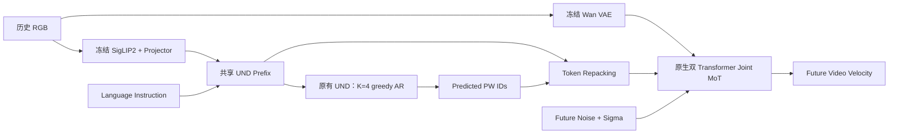

# PhysWord × Cosmos3-Edge：核心设计审阅

本分支只保留 **12个文件**，用于审核 Physical Word → Video Generator 的架构和训练计算图。9个Python文件均从完整实现提交 `49dfb56` 原样摘出，未为展示重写算法。

这是代码审阅快照，依赖原生 Cosmos Framework，不是独立训练发行包。完整实现、测试和历史证据在 [`physword/m3-real-b-queue`](https://github.com/JiawangLi07/cosmos-edge-physword/tree/physword/m3-real-b-queue) 分支。底座为 [NVIDIA Cosmos Framework](https://github.com/NVIDIA/cosmos-framework)，基线提交 `55f0554`。

## 建议阅读顺序

| 文件 | 审核重点 |
|---|---|
| [training.py](core/training.py) | A+B+C调用链、teacher forcing错位、预测PW条件、连续RF与三项loss |
| [physword.py](core/physword.py) | K=4自回归、完整前缀重算、最后token flush、fresh repacking |
| [multimodal.py](core/multimodal.py) | 历史RGB进入UND、共享prefix、position IDs与预测位置、时序边界 |
| [losses.py](core/losses.py) | Word CE、冻结未来视觉target、FP32 cosine与invalid mask |
| [conditioning.py](core/conditioning.py) | 独立PW embedding/head、安全token映射、原生embedding兼容 |
| [config.py](core/config.py) | 动态词表、私有ID命名空间、词表指纹、默认recompute |
| [initialization.py](core/initialization.py) | 从预训练UND input embedding/LM head做可复现的subword均值初始化 |
| [optimization.py](core/optimization.py) | Phase A/B、完整参数名选组、冻结范围、真实梯度及更新核对 |
| [preprocessing.py](core/preprocessing.py) | RGB变换、VAE像素与latent归一化的可执行协议 |
| [native_integration.patch](native_integration.patch) | 对原生packing、网络输入、RF等7个文件的实际改动 |

`core/physword.py` 原位置为 `cosmos_framework/inference/physword.py`；其余8个Python文件原位置为 `cosmos_framework/model/generator/physword/`。源码中的import路径保留完整工程原样。

## 保留的架构



只有原 Cosmos3-Edge 的 UND / GEN 两个Transformer分支。两次调用UND复用同一组参数；没有第三个Transformer、Final-z Injection、Action或Tactile Conditioning。

同样本内，UND是因果attention，不能读GEN；GEN可以读取整个UND和GEN。PW经过每层UND的contextual计算产生K/V，GEN通过原生MoT读取这些逐层K/V。没有把最后的hidden state直接注入GEN，也没有把AR cache直接交给GEN。

`native_integration.patch` 中，`packers.py`接收统一prefix并保留索引/位置，`cosmos3_vfm_network.py`对PW和RGB features进行embedding/scatter；原生 `mot/attention.py` 和 `mot/unified_mot.py` 没有架构改写。

## A+B+C训练图

```text
A（有梯度）
History RGB + Instruction + start + previous GT words
    → causal UND → prediction hidden states
    → V类Word Head → masked CE
    → 对齐冻结视觉编码器提取的独立未来帧target → cosine loss

B（无梯度）
原始History/Instruction Prefix
    → K=4 greedy AR → Predicted PW IDs

C（有梯度）
History/Instruction Prefix + Predicted PW IDs
    → fresh embedding lookup + Token Repacking
    → Joint MoT → native Video Flow Matching Loss

L_total = L_video + lambda_word * L_word + lambda_latent * L_latent
```

Teacher forcing位置为 `C..C+3`，输入分别为start、w1、w2、w3；监督分别为w1、w2、w3、w4。因此预测wk的hidden不能读取当前GT wk。无效前词反馈使用neutral start，不捏造GT类别。C仅使用B预测的词，不使用Oracle条件；离散argmax不求导，但C重新lookup embedding后保留video→UND K/V→PW table的梯度。

实际Edge shapes：历史RGB `[5,3,H,W]`，未来RGB target `[16,3,H,W]`，`Z_TF=[1,4,2048]`，`word_logits=[1,4,V]`，PW embedding为`[V+1,2048]`。V由冻结词表决定，当前左臂pilot为7类，配置中的16类为legacy默认。未来RGB不进入Reasoner条件。

10Hz、5帧历史、16帧未来、K=4、stride=4；最后历史帧之后的PW/video horizon都是1.6秒。视觉target对应clip帧8/12/16/20，分别独立编码并spatial mean pooling。Wan VAE的5/21帧得到2/6个latents，视频条件使用history-only编码的前2个latents。

连续RF保持 `t=1000*sigma`、`x_sigma=(1-sigma)*x0+sigma*epsilon`、`target=epsilon-x0`；history mask保持历史干净并排除其loss。复用原生timestep embedder及loss reduction/weighting，原生video scale=10只应用一次。

Phase A优化CE+latent，训练PW/head与选定UND层，冻结GEN/vision/projector/VAE。Phase B启用A+B+C，按配置解冻GEN、`k_norm_und_for_gen`及所选UND/PW参数。末层UND K/V可以收到video梯度；其后FFN/final norm/head没有直接video梯度符合计算图，CE/latent提供相应监督。

## 请重点检查

1. Shift与mask是否阻止当前GT/未来RGB泄漏。
2. AR与repack的prefix、RGB features、mRoPE和最后token是否一致。
3. GEN是否从每层UND K/V使用PW，video梯度是否回到预期参数。
4. 三项loss的target、有效mask、冻结范围和权重是否正确。
5. 10Hz的PW时域是否与生成视频未来时域一致。

当前证据：Tiny完整A+B+C及相关回归已通过；真实默认recompute T06的3个窗口/423项比较零差异；真实PW/head-only Phase A更新与跨进程恢复通过。**完整真实Phase B仍待空卡执行；尚无正式拟合或视频质量提升结论。** 完整证据留在开发分支，不在此分支重复堆放。

项目保留原始版权声明与 [LICENSE](LICENSE)。
