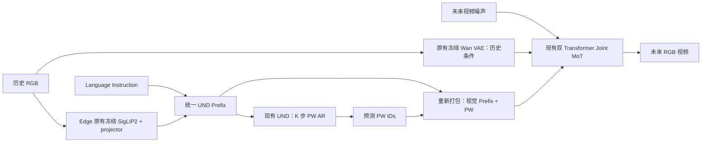

# PhysWord × Cosmos3-Edge Implementation Plan

> 历史基线文档（原始代码 `55f0554`）。当前实现与验收状态见 [PhysWord 项目说明](../README_PHYSWORD.md) 和 [M3 验收](physword_m3_acceptance.md)。文中的本地论文/权重路径是审计来源，不随源码仓库发布。

**状态：架构设计，尚未实施。** 2026-11-01，基于 Framework commit `55f0554d0bf167603432041c794a8babbac759b9`。本文件中的新增类、字段和配置均为拟议接口，不能直接当作当前仓库已有 API 执行。

配套：[可见性根因](pw_visibility_root_cause.md)、[架构与 shape 审计](physword_architecture_audit.md)、[静态证据](audit_evidence.json)。

## 1. 选定方案与边界

主方案是 **RGB-conditioned PW Autoregression → Token Repacking → Joint MoT Forward**。复用同一份 Edge UND / GEN 参数；Reasoner 前向执行两次不代表新增 Transformer。



严格配置：`action_gen=false`、`sound_gen=false`、无 tactile / proprioception / action features、无 action expert、无 PhysWord 原 Backbone。使用已存在的 RGB encoder / VAE，不增加新 Transformer。可输出 PW 文本供观察，但生成器输出任务只包含未来 RGB video。

第一版限定单视角输出、单语义 PW 轨迹、一个 visual token / block、`K=4`、`H_future=16`、`stride=4`。历史 RGB 可以有多帧；多帧历史不等于 multiview attention。并行双臂语义、多相机输出、three-way / temporal-causal GEN 均不列入首版。

基础 attention 选择 `two_way`，`video_temporal_causal=false`，`causal_training_strategy="none"`。PW 自回归的因果性属于 UND，不需要打开 GEN 的 temporal-causal 视频机制。

## 2. 实施前必须固定的版本与资源

1. 以本次代码 commit 为基线；固定模型权重、VAE、processor、tokenizer 的 revision 和哈希。
2. 本地模型目录当前为源码/元数据克隆，权重和 `tokenizer.json` 是 LFS 指针。未来执行 M0 时补齐完整 tokenizer、UND、GEN、vision encoder、VAE；核验文件格式，不能把指针当成模型文件。
3. 官方 Edge SFT 的 tokenizer revision 与本地 snapshot 不同；使用与已选权重匹配的本地 processor，分别验证 tokenizer IDs / special IDs / 最大 ID / embedding rows / LM head rows。
4. 核验实际 `embed_tokens.weight is lm_head.weight`。配置中有顶层 `tie_word_embeddings=false` 与构造参数 `tie_word_embeddings=true` 的不同设置；不可只看其中一个决定新词参数布局。
5. 记录未修改的原始视频 forward 输出作为回归基准。首先关闭 compile、CP、CFGP、batched CFG、diffusion cache、推理 text-KV cache，单样本跑通后再逐个启用。
6. 冻结且固定 Edge SigLIP2 + projector 和 Wan VAE；记录 teacher 的版本，防止 latent target 随训练漂移。

这一阶段只做资源准备和小规模 forward 验证，不包含训练启动命令。

## 3. 词表和训练参数布局

### 3.1 语义词表

```text
<pw_start>
<pw_approach_v> <pw_move_v> <pw_pick_v> <pw_place_v>
<pw_flip_v> <pw_rotate_v> <pw_toggle_v> <pw_open_v>
<pw_close_v> <pw_push_v> <pw_pull_v> <pw_insert_v>
<pw_press_v> <pw_click_v> <pw_strike_v> <pw_handover_v>
```

固定词顺序和 `class_id=0..15`；`class_id` 与 tokenizer ID 分开保存。Start 不属于 16 类预测目标。固定 K 步解码，不使用自由文本 EOS 决定 block 数；16 类 head 本身约束每步只能产生合法 visual PW。重复 `move` 是合法行为，PW 解码不使用通用文本重复惩罚。

### 3.2 推荐：小型 PW embedding / head 置于 `net` 下

拟议 `net.physword` 包含：

```text
pw_embeddings: nn.Embedding(17,2048)       # 34,816 参数
word_head:     nn.Linear(2048,16,bias=False) # 32,768 参数
token_id_to_pw_index / class_to_token_id    # checkpoint buffers / manifest
```

这是词嵌入和线性读出，不是额外 Transformer。它避免仅训练 17 行却为原始 `131072×2048` 大矩阵分配全量 Adam 状态。

Tokenizer 注册 17 个独立 token，保存其真实分配结果。**不要硬编码从 131072 开始，也不要未经核验复用 `<SPECIAL_*>`。** 模型的 base vocabulary 有 padding rows，tokenizer 的真实长度尚未加载核验。

新增共享 `embed_reasoner_tokens(ids)`：

1. 根据显式映射标记 PW IDs；普通 ID 保持原值。
2. PW ID 暂替换为合法 base ID，仅用于安全调用原 `embed_tokens`。
3. 在这些位置用 `net.physword.pw_embeddings` 的结果替换，保持 autograd。
4. 在视觉占位位置 scatter 冻结的历史 RGB features。

这样新增 ID 即使超出原 embedding rows，也不会越界；即使落在原矩阵预留范围内，也会优先使用 PW 映射。普通文本生成继续使用原 `lm_head`，PW 生成专门调用 16 类 head。

新词初始化：使用冻结的原 tokenizer 对普通动作词的 tokenization，平均对应 base input embeddings 初始化 visual PW；word head 可以用 base LM head 对应 rows 的均值初始化。多 subword 时记录分解和均值规则；不能假设 16 个动词都只有一个 token。`<pw_start>` 使用预先选定、记录在 manifest 的已有起始语义向量初始化。

替代方案是扩展完整 embedding / LM head 并精确控制新增行更新。它更兼容通用 HF generate/export，但需处理权重绑定、旧 checkpoint shape、逐行 optimizer 状态与 weight decay。本项目首版采用上述独立小表，承认其需要 Framework 自定义 PW loader；通用 HF 导出不在首版验收范围。

所有新增可训练 head 必须在 `model.net` 下、FSDP/optimizer 构造之前注册。否则 [optimizer.py:270](../cosmos_framework/utils/generator/optimizer.py:270) 的 `model.net.named_parameters()` 不会收集它。

## 4. 精确的输入–目标错位

令 `C_i` 包含历史视觉占位 tokens、指令、原生 chat role markers 和必要的时间信息，长度 `L_i`，不包含 `<pw_start>`。第一版的“block”就是一个 visual Word。

Teacher forcing：

| block k | 全序列预测位置 `p_k`（样本内） | 该位置输入 | 该位置监督 |
|---|---:|---|---|
| 1 | `L_i` | `<pw_start>` | `w1_GT`，`g1` |
| 2 | `L_i+1` | `w1_GT` | `w2_GT`，`g2` |
| 3 | `L_i+2` | `w2_GT` | `w3_GT`，`g3` |
| 4 | `L_i+3` | `w3_GT` | `w4_GT`，`g4` |

```text
Teacher input: C | start | GT(w1) | GT(w2) | GT(w3)
Targets:                w1        w2        w3        w4
Z:                   z1        z2        z3        z4  ∈ R^(4×2048)
```

推理：同一 prefix，只把前一步 `argmax(word_head(z_k))` 对应的 PW embedding 回填；当前/未来 GT 词和未来图像均不能参与输入。

Generator 的 repack 可以包含完整的预测结果：

```text
C | start | pred(w1) | pred(w2) | pred(w3) | pred(w4) | EOS | BOV | GEN
```

此时 `pw_prediction_positions=[L,L+1,L+2,L+3]`；`pw_token_positions=[L+1,L+2,L+3,L+4]`。**它们相差一格，不可混用。** `pred(w4)` 后的 hidden 没有 `w5` 目标，但作为条件仍可给 GEN 读取。标准 AR loop 生成最后一个 token 后即返回，其 cache 尚未处理这个 token；直接 cache handoff 还必须处理这一 off-by-one。

CE / latent 索引只选择预测位置。不要沿用 [sequence.py:277](../cosmos_framework/data/generator/sequence_packing/sequence.py:277) 对一般 caption 构造的整段 CE labels，也不要把 EOS/BOV 监督成 Physical Word。

## 5. Typed condition 与 PackedSequence 扩展

拟议 `ReasonerCondition`（单样本，组 batch 前创建）：

```text
input_ids                 [U_i] int64，已包含指定 prefix / PW / 边界
position_ids              [3,U_i]，实际多模态 mRoPE
history_feature_indexes   [R_i] int64，局部 UND 位置
history_features          [R_i,2048]，冻结 SigLIP2+projector 输出
pw_prediction_positions   [K] int64，局部 UND 位置
pw_token_positions        [K] int64
pw_visibility_region      [U_i] bool，start 到 EOS/BOV 的整个 suffix
sample_id / prefix_hash / model_revision / fps / target_offsets
```

Teacher labels、未来 targets 使用独立 `PhysWordTargets`，不放进推理 condition：

```text
word_class_targets        [B,K] int64
future_visual_targets     [B,K,2048] fp32 / bf16，requires_grad=False
valid_word / valid_latent [B,K] bool，可分别缺失
```

PackedSequence 新增 optional payload：`reasoner_visual_features`、`reasoner_visual_indexes`、`pw_prediction_indexes`、`pw_token_indexes`、`pw_suffix_indexes`、`pw_sample_ids`。打包后的位置必须是**全 buffer global indexes**，而非各样本局部序号。

`pack_input_sequence(..., reasoner_conditions=None)` 保留原 caption 路径；有 condition 时调用拟议 `pack_reasoner_condition()`：

1. `append_text_span` 一次性写入已准备的 UND IDs 和精确 positions；不给它再套一遍 chat template。
2. 历史视觉 placeholder 仍在 `text_indexes` / UND causal stream，不进入 `vision.sequence_indexes`。
3. 样本只建一个 UND causal split；`text_caption_lens=[[U_i],...]`，`text_caption_view_ids=[[-1],...]`。
4. GEN 构造复用现有逻辑，所有历史 VAE latents / noisy future 仍走 GEN。
5. `split_lens=[U_0,G_0,U_1,G_1,...]`；`sample_lens=[U_0+G_0,...]`；`attn_modes=[causal,full,...]`。
6. `finalize()`、`.to_cuda()` 和 metadata 构造携带新增字段；每次修改 token 数重新构造 offsets / indexes / metadata，不在已缓存 pack 上原地追加 IDs。

在 [cosmos3_vfm_network.py:885](../cosmos_framework/model/generator/mot/cosmos3_vfm_network.py:885) 中使用共享 embedding helper，补上 RGB scatter。其后的 `build_packed_sequence` / 原 MoT 可以沿用。

## 6. 视觉特征与 position parity

使用当前 [reasoner_multimodal_utils.py:38](../cosmos_framework/model/generator/reasoner/nemotron_3_dense_vl/reasoner_multimodal_utils.py:38) 的处理规则；把“processor 输出 / 视觉 features / position IDs”准备成 AR 和 joint forward 共用的结构。现有 helper 内直接调用 base embeddings，需要抽取或扩展以支持 PW embedding helper；不能把新 ID 原样送入旧 lookup。

历史 RGB 特征：单帧处理后 patch grid 为 `(h_p,w_p)` 时，`R_frame=h_p*w_p/4`，输出 `[R_frame,2048]`。实际按 processor 返回 grid 计算，不按原图面积猜测。保持 raster / channel layout，参照 [cosmos3_edge_processing.py:11](../cosmos_framework/data/generator/processors/cosmos3_edge_processing.py:11)。

AR 与 joint 的 UND 前缀要满足：IDs、RGB features、有效 token 数、role boundaries、权重、norm、mRoPE 和 dropout 状态一致。重用 `get_rope_index()` 的 `[3,1,U]`，去掉 batch 维放入 packed 的 `[3,U]`；不要用普通 text positions 覆盖视觉 grid。

PW decode 的位置沿用原 AR `cache.seq_len + mrope_position_deltas` 约定。构建完整 repack positions 时必须与这组实际位置逐项相等。EOS/BOV 位于 PW 之后，使用一致的 text continuation 位置。GEN 的时间轴从完整 UND 已用坐标的后续位置加原有 `15000` margin，空间轴按原配置 reset；不把 cache 物理长度误当多模态坐标最大值。

`<pw_start>` / 词 token 的文本 RoPE 顺序不等于未来物理秒数。第一版固定 `K=4`、`stride=4`、采样 FPS，目标偏移由数据协议定义；若变更 stride / horizon，需在 prefix 中明确提供已知目标时间表，并重新训练 / 验证，不能静默复用。

## 7. Attention 设计

设同一 sample 的 `C` 为历史视觉与语言 prefix，`P` 为 start、预测词反馈与边界 suffix，`G` 为视频 latents：

| Query → Key | C | P | G |
|---|---|---|---|
| C | 原 UND causal | 禁止 | 禁止 |
| P | 允许 | 因果：key_position ≤ query_position | 禁止 |
| G | 允许 | 全部已预测的 P | 原 two-way full |

全局 mask 还必须满足相同 sample 和有效非 padding。使用现有 `two_way_attention()` 即可实现这个主路径，不添加 token-type cross-attention Transformer。

**当前 token 对自己的输入可见不代表读取当前 GT 目标。** 在 `p_k` 放的是 `w_(k-1)`，所以合法；目标 `w_k_GT` 在 teacher input 中位于后一个位置，被因果性屏蔽。

保持 Edge 的 `k_norm_und_for_gen` 在 RoPE 前作用于 UND K，UND 自注意力仍使用原始 K。GQA 16:8 保持不变；不要手动重复 KV 后再让 backend 重复一次。

默认“可见”不意味着一定“依赖”。原 GEN 仍可从 RGB / language 直接完成任务；是否使用 PW 要靠第 13 节的干预和对照实验判定，不能靠 attention heatmap 或 CE accuracy 单独证明。

### 正确的 mask-out 消融

只禁止 `GEN→w1..w4` 不足以隔离 PW：EOS/BOV 和后续 UND tokens 已能因果读取 PW，后续 GEN layers 也可能传播前层已读入的 PW。

正式的 auxiliary-only / visibility-off 版本需：**每一层 GEN 都不能读取整个 P suffix，包括 start、反馈词、EOS/BOV**，且禁止把同一 PW 信息写入其他 context 或持有旧 KV cache。C 位于 P 之前，本身不能读 P，因此是合法未污染上下文。

主 kernel 不改。拟议诊断 dispatcher 复用现有 UND causal 计算，只为 GEN 逐样本组装 `[C keys; G keys]`，保留所有 Query、token 数、positions 和权重；用现有 dense/varlen attention API 计算。tiny test 可用显式 bool mask 作为参考。不要以把 K/V 置零代替屏蔽：零 K 仍会占 softmax mass。

在 mask-out 条件下交换 PW IDs，GEN 输出应与自身数值噪声基线相同。这比仅比较 visible / masked 两个输出更能检验有没有残留旁路。

## 8. 数据与时间对齐

拟议训练记录：

```json
{
  "episode_id": "...",
  "instruction": "...",
  "history_frame_indices": [0, 1, 2, 3, 4],
  "future_frame_indices": [5, 6, 7, 8, 9, 10, 11, 12, 13, 14, 15, 16, 17, 18, 19, 20],
  "source_timestamps_seconds": "每个抽样帧的实际时间戳",
  "model_fps": 10,
  "pw_target_frame_indices": [8, 12, 16, 20],
  "pw_class_targets": [2, 1, 1, 3],
  "pw_valid_mask": [true, true, true, true]
}
```

图像路径 / 解码结果另行存储；不提供 action / tactile 张量。GT PW 和 future RGB 仅训练 / 评测读取。推理 API 只接收 history、instruction、horizon 等公开采样参数。

**一个具体 shape 例子**（设计示例，不是当前实测）：

- 历史 5 帧，未来 16 帧，均为 256×256，10Hz；完整 clip 为 21 帧。
- VAE latent `[1,48,6,16,16]`；latent 时间对应输入帧右边界 `0,4,8,12,16,20`。
- 历史 condition latent indexes `[0,1]`；未来 noisy indexes `[2,3,4,5]`。
- GEN patch grid `[6,8,8]`，`G=384`；其中历史 128 patches、未来 256 patches。
- 假设 Reasoner processor 保持每帧 256×256，则每帧 64 个合并视觉 tokens、历史共 320。若其余 context 为 100 tokens，则 `L=420`，完整 UND `U=420+1+4+2=427`，总 real packed length `811`。
- `Z` / future target `[B,4,2048]`；word logits `[B,4,16]`；视觉输出解码裁掉历史前缀，只评测未来 16 帧。

此方案符合 VAE `1 mod 4` 长度。任意长度按 [args.py:705](../cosmos_framework/inference/args.py:705) 会被向上调整，故必须保存 resolved frame count，不能只使用请求值。非 `1+4m` 历史长度需要重采样/补齐并显式记录，避免某个“历史” latent 混入未来 frame。

Wan VAE 实现为 causal，见 [wan2pt2_vae_4x16x16.py:1005](../cosmos_framework/model/generator/tokenizers/wan2pt2_vae_4x16x16.py:1005)。仍需验证“仅历史编码”与“历史+未来编码的历史前缀”一致；这是防止边界/预处理引入未来泄漏的测试，不以注释代替实测。

10Hz 在当前代码建议 FPS 范围 [10,30] 内，但 21 帧是短片研究设置，可能触发长度建议提示，不能等同于 checkpoint 在此条件下质量已经验证。FPS 位置由 [mrope.py:72](../cosmos_framework/data/generator/sequence_packing/mrope.py:72) 调制。Word 标签按真实时间映射 stage，避免把 source FPS、model FPS、playback FPS 混用。

按 episode 先做 90/10 划分，再生成重叠窗口；跨 episode 去重也先于划分。采用论文 Appendix A.3 的 stage boundary 标注格式，加入人工抽检和边界容差。无有效未来 frame / 标签的 block 使用 valid mask；固定长度解码仍生成 K 步，训练仅对 valid targets 计损失。

## 9. 三个损失与计算位置

### 9.1 Word CE

```text
Z_TF = UND(C + start + GT(w1..w(K-1))) 在 pw_prediction_positions 的输出
logits = word_head(Z_TF)                      [B,K,16]
L_word = Σ valid_word * CE(logits, labels) / max(Σ valid_word,1)
```

head 读取最终 UND norm 后的 state。输出只有 16 类，无需构造 `[N_all,131072]` 的全词表 logits。`predict_text_tokens=true` 不能替代此逻辑。

### 9.2 Future Visual Latent Loss

首版选用**同一 Edge SigLIP2 + 冻结 PatchMerger** 的投影输出：

```text
I_future(t+ks)
  → frozen Edge native image processor
  → frozen SigLIP2 final features [N_patch,1152]
  → frozen spatial merge + projector [N_merge,2048]
  → spatial mean pooling [2048]
  → stop_gradient g_k
```

实际可复用 [vision_siglip2.py:457](../cosmos_framework/model/generator/reasoner/nemotron_3_dense_vl/vision_siglip2.py:457) 的 `get_image_features()`，再按各图 grid 分段 mean。所有 future frames 独立编码，不能把其他未来帧的信息通过时间 attention 混入 target；当前 SigLIP2 本身无时间 attention。

```text
L_latent = mean_valid(1 - cosine_similarity(float32(Z_TF), float32(G_future), eps))
```

这使目标和 `z_k` 都是 2048 维，第一版不增加可训练 target projection。若选择 raw SigLIP2 1152 维 target，则需要单独的预测侧 `2048→1152` projector，属于明确不同的实验，不能直接计算不同维度 cosine。

注意：同为 2048 维不证明两种空间天然对齐；这里冻结已有 visual projector 保持 target 稳定，通过 loss 学对齐。pooling 可能丢失细粒度空间信息，应监测 target 方差、跨场景 cosine 和预测 collapse。

### 9.3 原 Video Flow Matching

复用 [training_step:1495](../cosmos_framework/model/generator/omni_mot_model.py:1495)、[_compute_losses:1902](../cosmos_framework/model/generator/omni_mot_model.py:1902)、[flow_matching.py:50](../cosmos_framework/model/generator/algorithm/loss/flow_matching.py:50)。

```text
x_sigma = sigma * eps + (1-sigma) * x0
target_v = eps - x0
condition history: 保持 clean，并从 loss 中 mask
future: 使用原 scheduler / timestep weighting / loss reduction
L_total = L_video_existing + λ_word L_word + λ_latent L_latent
```

官方 Edge 配置的 `loss_scale=10` 已包含在 `L_video_existing` 中；不要再乘一次。初始 `λ_word=1, λ_latent=1` 仅为待验证配置，记录每个损失及各参数组 grad norm 再调平衡，不照搬论文学习率或声称天然平衡。

### 9.4 三条训练计算分支

```text
共享原始样本（仅 history + instruction 是输入）
  A. Teacher-forced UND（有梯度） → Z_TF → CE + latent
  B. 同一 UND，K 步 greedy rollout（no_grad） → predicted IDs
  C. 同样 history prefix + predicted IDs → joint MoT（有梯度） → video loss
```

A 的 GT words 不得出现在 C 的视频条件里；B 也不得使用 GT words。不要在 C 的 `Z_pred` 上声称获得了 teacher-forced CE。初期可分别 backward A 和 C、在同一 optimizer step 累积，以减少同时存两张图的内存；须正确处理 FSDP sync 与 grad accumulation。

若 B 使用离线缓存预测词，必须记录 producer checkpoint / prefix / preprocessing 版本；Reasoner 持续更新时在线 rollout 优先，避免陈旧预测分布。

## 10. 分阶段解冻与梯度

### Phase A：先建立 PW 推理能力

- 冻结 GEN、原 base token embeddings、原 LM head、SigLIP2、projector、VAE。
- 训练 PW embedding 小表和 16 类 word head。
- 为形成可泛化 latent reasoning，解冻 UND 最后若干层的普通 attention / FFN / norm；建议从最后 4 层开始，是研究选择，不是已验证最优值。最终 UND norm 参与 CE/latent。
- 用纯 UND differentiable forward 计算 CE/latent，不调用带 `@torch.no_grad()` 的通用 `generate_reasoner_text()` 来计算训练损失。
- 冻结大部分 UND 参数不等于对整段 forward 用 `no_grad()`：PW embeddings 的梯度还需穿过冻结层。

### Phase B：让视频条件路径适配 PW

- B0 调试阶段可固定 UND / PW head，只训练现有 GEN 参数和 `k_norm_und_for_gen`，确认条件路径可用。
- 正式 B1 解冻 PW embeddings，以及 UND 后若干层的 K/V 和可影响下一层 K/V 的 block 参数；联合保留 A 分支 CE/latent，避免 Word 能力漂移。
- GEN 训练范围：原白名单 `moe_gen`、`time_embedder`、`vae2llm`、`llm2vae`、`k_norm_und_for_gen`。若启用额外视觉 modality embedding，也要显式收集；默认不新增此功能。
- 原 base embeddings 可保持冻结，PW 小表可单独优化。
- 初始 LR 可设 GEN 1e-5、UND 1e-6、PW table/head 1e-4 作为保守试验起点；所有结论以小样本收敛和梯度验证为准。

### Phase C：选择性联合微调

只在 Phase A/B 验收通过后按验证曲线扩大 UND trainable layer 集合；独立记录各组 LR。分阶段改变可训练集合后必须重建/迁移 optimizer，不能只是 `requires_grad=True` 就认为旧 optimizer 会包含新参数。

### Video loss 的实际梯度路径

```text
L_video → llm2vae → GEN blocks
        → Attention(Q_gen,K_und_for_gen,V_und)
        → UND K/V projections、input norm、之前 UND layers
        → 第二次 forward 的 PW embedding / 可训练 prefix 参数
```

没有到 `argmax` 选择的梯度，也没有从 joint GEN 输出到最后一层 UND 输出 FFN / 最终 UND norm / 独立 word head 的直接梯度。CE/latent 分支负责后者；有选择性共享参数不等于对离散决策做了端到端优化。

梯度检查需要分别执行 `L_video.backward()`、`L_word.backward()`、`L_latent.backward()`，不能用总 loss 的非零 grad 证明视频通路连通。冻结组允许 `grad=None`；预期可训练 K/V 和 PW embedding 应在非退化样例中非零。验证梯度后还要检查 optimizer step 的实际参数差异。

优化器设计：先按**完整参数名**建立集合，显式设置冻结，再把允许集合映射到配置。当前 `keys_to_select` 是 substring 规则，`self_attn.q_proj` 也可能匹配 `q_proj_moe_gen`；不可用粗短字符串宣称只解冻某一路。输出 trainable names、numel、LR、是否进入 optimizer、是否属于 EMA。

建议提供 `pw.enabled`、`freeze_reasoner`、`train_pw_embeddings`、`train_word_head`、`train_generator`、`joint_train` 和 `reasoner_trainable_layers`；phase 与这些开关不一致时直接报错。

## 11. 推理控制流程与缓存

```text
1. 验证输入仅有 history RGB + instruction；解析 resolved FPS/frames。
2. 用固定 processor 构建 C；提取冻结历史视觉 features 和 mRoPE。
3. 同一 net 的 UND 以 start 为第一个预测位置，执行 K 次受限 greedy decode。
4. 保存 PW IDs、class IDs、prefix hash、预测位置；不做 decode→clean→retokenize。
5. 用相同 C 和预测词重建 ReasonerCondition。
6. 与 VAE history condition / noisy future 组装 PackedSequence。
7. 循环原视频 denoising；每次 joint MoT 读相同 PW 条件。
8. VAE decode，裁掉历史部分，输出未来视频及可选 PW 解释。
```

首版推荐实现独立 `generate_physical_words()`，内部复用 `model.reasoner_forward` / `ReasonerKVCache`，不修改通用 `_sample_next_token` 的语义。训练入口 `forward_physical_words()` 是有梯度 teacher pass；两者都使用同一个模型实例。

当前 `reasoner_forward` 没有通用 ragged padding mask 参数，见 [unified_mot.py:946](../cosmos_framework/model/generator/mot/unified_mot.py:946)。首版 B=1 或等长 bucket；不要将左 padding 当作已被 attention 屏蔽。扩展多样本 AR 时要显式加入有效长度/varlen，否则只能沿现有 wrapper 的逐样本模式执行，并保证 FSDP ranks 调用次数一致。

首版 PW 路径在 `_can_reuse_inference_text_kv()` 返回 False，也禁用 diffusion cache 和 CUDA graph。通过 parity 后，首个**joint Forward**生成正确规范化 UND KV，之后复用现有 `InferenceTextKVMemoryState`。cache key 至少含：模型权重/EMA版本、完整 prefix/视觉 features 哈希、PW IDs、positions、CFG 分支、sample layout；任何改变都使缓存失效。

这比直接转接第一次 AR cache 更低风险。后者需额外处理 raw post-RoPE K 与 `RMSNorm-before-RoPE` K 的区别、最后一个已采样 token 不在 cache、batch packing、梯度、CP/CFGP 和层索引，暂不实施。

CFG 第一阶段用 `guidance=1` 做可见性测试。随后明确条件定义：cond=`RGB history + instruction + predicted PW`；uncond=`同一 RGB history + null language + 无 PW`。训练时对 language/PW 联动 dropout，不能只 drop instruction 却留下由 instruction 推理出来的 PW。cond/uncond 分别构建 prefix、positions、pack 和 cache。native no-PW baseline 保留原 CFG 协议；比较实验另设同样扩展 RGB prefix 的匹配 baseline。

## 12. 准确代码改动清单

以下只列计划，不代表已经修改。新文件均建议置于 `cosmos-framework/` 内，以便后续独立提交。

| 文件 / 现有位置 | 拟议修改及责任 |
|---|---|
| 新 `cosmos_framework/model/generator/physword/heads.py` | `PhysWordHeads`，17 行 embedding、16 类 head、初始化、token ID 映射；挂在 `net.physword` |
| 新 `.../physword/conditioning.py` | `ReasonerCondition` / `PhysWordTargets` / `PhysWordPrediction`；prefix、位置、RGB features 的统一构建与校验 |
| 新 `.../physword/reasoning.py` | 有梯度 teacher forcing、固定 K 步生成、class-to-token feedback；调用现有 UND |
| 新 `.../physword/losses.py` | valid-masked CE / fp32 cosine；future teacher encode / pooling 或缓存 |
| [sequence.py:1239](../cosmos_framework/data/generator/sequence_packing/sequence.py:1239) | `PackedSequence` optional PW / UND visual payload；同步 `finalize:1096`、`to_cuda:1408`、metadata 生命周期 |
| [sequence.py:905](../cosmos_framework/data/generator/sequence_packing/sequence.py:905) | 复用 `append_text_span`，新增 `pack_reasoner_condition`，显式处理边界，保持 single causal split |
| [packers.py:326](../cosmos_framework/data/generator/sequence_packing/packers.py:326) | `pack_input_sequence` 接收 typed conditions，先构造完整布局，再 finalize；不做事后拼接 |
| [cosmos3_vfm_network.py:885](../cosmos_framework/model/generator/mot/cosmos3_vfm_network.py:885) | `_encode_text` 改用 shared embedding helper，scatter UND history visual features |
| [cosmos3_vfm_network.py:1644](../cosmos_framework/model/generator/mot/cosmos3_vfm_network.py:1644) | `forward` 仅在需要时 gather PW prediction states；新增 top-level PW train/decode 入口 |
| [unified_mot.py:1908](../cosmos_framework/model/generator/mot/unified_mot.py:1908) | 复用 `_impl_reasoner_forward(inputs_embeds=...)`；原则上不改 attention 数学 |
| [reasoner_multimodal_utils.py:38](../cosmos_framework/model/generator/reasoner/nemotron_3_dense_vl/reasoner_multimodal_utils.py:38) | 提取共享 multimodal preparation，兼容 PW embeddings；避免 AR/joint preprocessing 分叉 |
| [omni_mot_model.py:493](../cosmos_framework/model/generator/omni_mot_model.py:493) | `build_net` 构造 PW module；按现有 materialize/load 顺序加载视觉塔、冻结、再并行化；EMA 同构 |
| [omni_mot_model.py:1000](../cosmos_framework/model/generator/omni_mot_model.py:1000) | `_pack_input_sequence` 透传 typed conditions，保持 PW-off 原路径 |
| [omni_mot_model.py:1495](../cosmos_framework/model/generator/omni_mot_model.py:1495) | `training_step` 连接 TF / predicted rollout / video 三分支；禁止 GT PW 污染视频条件 |
| [omni_mot_model.py:1902](../cosmos_framework/model/generator/omni_mot_model.py:1902) | 原视频 loss 保持；新增可选 PW loss 汇总与 valid reduction；可由小子类覆盖以减少基类侵入 |
| [omni_mot_model.py:6990](../cosmos_framework/model/generator/omni_mot_model.py:6990) | `denoise` 显式保留紧凑 `pw_hidden_states` 等必要输出；不能仍过滤掉 |
| [omni_mot_model.py:2944](../cosmos_framework/model/generator/omni_mot_model.py:2944)、[3493](../cosmos_framework/model/generator/omni_mot_model.py:3493)、[4065](../cosmos_framework/model/generator/omni_mot_model.py:4065) | `_prepare_inference_data` / `_get_velocity` / `generate_samples_from_batch` 连接 PW stage 和一致 pack，处理 CFG / template / cache |
| [inference.py:2155](../cosmos_framework/inference/inference.py:2155)、`inference/args.py` | 新 PW 开关和结构化输出；仍在视频生成模式运行，不能走 reasoner-only early return |
| [parallelize_vfm_network.py:213](../cosmos_framework/model/generator/mot/parallelize_vfm_network.py:213) | 为新增 `forward_physical_words` / `generate_physical_words` 注册 top FSDP forward methods；沿用 per-layer `reasoner_forward` 注册 |
| [parallelize_unified_mot.py](../cosmos_framework/model/generator/mot/parallelize_unified_mot.py) | 审查新增 PW method 的 activation checkpointing / compile 支持；当前 AC 装饰普通 forward 不一定覆盖新 method |
| 新 `data/generator/physword_dataset.py` | episode split、RGB history/future、原子词 stages、valid mask、时间对齐；不能复用 action dataloader 再忘记删条件 |
| [packing_iterable_dataset.py:271](../cosmos_framework/data/generator/packing_iterable_dataset.py:271) | 新 dataset/packer 的 token cost 必须包含 UND RGB、PW 和边界；不要只计 caption + VAE |
| `configs/base/defaults/model_config.py`、`configs/toml_config/sft_config.py` | 新可选 PhysWord 配置 schema、严格范围验证、默认 disabled |
| 新 `configs/base/experiment/sft/physword_edge.py`、`examples/toml/sft_config/physword_edge.toml` | 独立实验配方，继承 Edge 视觉 SFT，action/sound 显式 false；原 recipe 不改 |
| [optimizer.py:204](../cosmos_framework/utils/generator/optimizer.py:204) | 尽量复用现有 factory，增加运行时参数集合审计；必要时增加精确名单选择，避免 substring 冻错 |
| [omni_mot_model.py:6505](../cosmos_framework/model/generator/omni_mot_model.py:6505) 及 checkpoint/export 工具 | 新 PW 状态、tokenizer mapping、teacher hash、phase config；基座→扩展加载和断点续训分别校验 |

**不作为首版主改动点**：独立 HF `modeling_cosmos3_edge.py`、`two_way_attention` 数学、原 PhysWord Backbone、action/tactile 模块。诊断 mask dispatcher 是可选测试/消融入口，不能混入默认 attention 分支。

若未来启用 CP，还必须扩展 `_pack_training_payload` / `_unpack_training_payload` 和 raw vision 生命周期（[omni_mot_model.py:1358](../cosmos_framework/model/generator/omni_mot_model.py:1358)），以防 teacher labels、history features、sample identity 在 CP 窗口轮转后错配。首版对此 fail fast。

## 13. 验收测试：从结构到因果使用

下面都是**待实施测试**，本次没有伪称通过。tiny 模型测试先使用相同 Edge dual-path 类、缩小层数/hidden，但保留 GQA 与 UND K norm；随后以真实权重复验。

| ID | 测试 | 通过标准 / 主要排除的问题 |
|---|---|---|
| T01 | PW-off 回归 | 相同 seed / inputs / 已有配置下 outputs 与原 commit 在既定容差内一致；不新增参数更新，不变更 pack |
| T02 | Token presence / packing | 全部预测 IDs 在对应样本 UND；pred positions 与 token positions 区分；索引/offsets/shape 一致；padding 不计入有效长度 |
| T03 | Shift / target 泄漏 | 改动 `w_k_GT` 后，预测 `w_k` 的 state/logits 不变；后续合法位置可变。改未来 RGB 不改变 AR PW；仅改变 targets/noising target |
| T04 | Attention 单层参考 | 实际 two-way 与 explicit-mask 参考前向及梯度一致；GEN→PW 允许、PW→GEN 禁止、跨样本禁止 |
| T05 | Sample isolation | 修改样本 B 的 PW、RGB，不影响样本 A；覆盖 varlen、不等长、padding |
| T06 | AR / repack parity | 相同预测轨迹下逐层 UND hidden/K/V 和最终 `Z` 一致；分别比较 raw UND K 与 gen-normalized UND K；位置 ID 必须 exact match |
| T07 | PW intervention | 固定 RGB/指令/模型/noise/sigma/positions/长度，`approach→pick→move→place` 与 `approach→push→move→place` 的有效未来 velocity 有稳定非零差异 |
| T08 | 整个 PW suffix mask-out | visible/masked 有可解释差异；masked 模式再替换 PW IDs 后输出无超容差变化；所有层执行屏蔽，EOS/BOV 无旁路 |
| T09 | 真实 PW 梯度 | 仅 video loss 对预期 PW table / UND K,V / GEN 参数有梯度；frozen 不变；最后 UND FFN/norm/head 无 video 直接梯度不算失败 |
| T10 | optimizer 真更新 | 预期参数一步后改变；base/frozen 参数不变；每个 trainable 参数恰好在一个组，LR 正确 |
| T11 | Train / infer 条件一致 | 直接传入同一 predicted IDs、同一 prefix/noise/sigma，packed fields exact match；grad-mode varlen 与 no-grad dense 输出在容差内一致 |
| T12 | CFG / cache | conditional/unconditional 隔离；cache-off/on 一致；改 PW/RGB/权重触发失效；新请求不复用旧 cache |
| T13 | 视觉与 VAE 防泄漏 | 相同历史不同未来时 AR 输入/features 相同；VAE history prefix 单独编码与全 clip prefix 一致；未来仅 loss target |
| T14 | checkpoint / tokenizer roundtrip | 重载后 17 个 ID 映射、PW logits、预测词、one-step velocity 一致；只允许新增 PW keys 缺失，不吞其他 shape mismatch |
| T15 | 并行小 smoke | 单 GPU 通过后才做两 rank FSDP；同一 K 次前向与 backward，无 collective 次数不一致；新顶层方法能正确 unshard |
| T16 | 小数据学习与语义消融 | 固定训练预算比较 Full PW / auxiliary-only / shuffled PW；收益超越重复运行波动，且预测词质量与视频指标合理 |

T07 使用 `Δ = RMS((v1-v2)[future_mask])`，另报相对 Δ、重复同输入的 numerical floor、多层 GEN state 差异。先用 fp32 tiny model 得参考，再校准 bf16 实际 kernel 容差；不能随意设极小阈值把浮点噪声算有效信息流。

T08 和 T09 的条件一致性必须共同检查。仅看到一个 attention 权重或非零总梯度，无法证明 Video Loss 使用 PW。

T16 的核心对照：

- **Native Edge baseline**：完全关闭 PW，保留原推理协议。
- **Matched RGB-prefix baseline**：与 PW 实验相同的 UND RGB prefix，但不使用 PW；排除新增视觉条件带来的增益。
- **Full PW**：Word CE + latent + GEN 可见 PW。
- **Auxiliary-only**：同样的 PW 监督与训练预算，但 GEN 每层屏蔽整个 PW suffix。
- **No latent**：保留 CE，去掉 latent loss。
- **Shuffled / wrong / mask PW**：只在测试时干预，评估依赖性与语义变化。
- **Oracle PW**：诊断上界，独立标记，不列入只看历史的正式结果。

交接文档中的“latent-only + 无 CE + 仍离散预测 PW”需要修正定义：随机/未监督的 16 类 head 不会自动学会语义词。可以从同一个已完成 Phase A 的 checkpoint 去掉后续 CE，但应命名为“无联合阶段 CE”；若要求从头纯 latent reasoning，则要明确连续 slot / feedback 方案，是另一个实验，不能与未训练 word head 混用。

视频指标：只评 future、固定 rollout seeds，报告视频 flow loss、可用的 PSNR/SSIM/LPIPS 和合适的数据集物理/任务评估；短片/少样本不依赖单一 FVD。观察正确 PW 干预是否改变预期动作，避免把任意输出扰动当成物理推理成功。

## 14. 低侵入替代方案与最终 `z_k` 的问题

| 方案 | 改动 / 能力 | 结论 |
|---|---|---|
| PW 文本追加 caption | 几乎不改 packer；GEN 能读取词语义，默认丢失原视觉 reasoning states | 可作为 M1 文本连通探针，不能当完整 PhysWord |
| **统一多模态 prefix + token repack** | 扩展 packing / embedding 接口；复用原 joint attention | 主方案；读逐层 contextual PW representations |
| joint 首步后复用已有 UND KV | 不碰初始 AR cache，保留正确 norm / RoPE | 主方案验证后优先优化 |
| 将最终 `Z_pred` 回填为 UND soft-prefix | 增加 `[K,2048]` 连续 payload / 可选线性适配；仍只有两个 Transformer | 若要求直接使用最终 latent，这是更明确的备选 |
| AR layer KV 直接 handoff | 需 raw / normalized K、尾 token、位置、层映射、训练梯度适配 | 首版不选 |
| 新 cross-attention Transformer / PhysWord 原 backbone | 违反模型约束 | 排除 |

普通 repack 的验收口径必须写清楚：GEN 读取的是 PW 预测轨迹的各层 K/V，而不是最终 post-norm `z_k` 本身。若 mentor 要求直接的最终 latent 通道，建议使用 soft-prefix 备选，而不是模糊描述。

soft-prefix 的可执行版本：先 no-grad 得 predicted IDs，再有梯度 teacher-style 重放这些预测 IDs 得 `Z_pred`（不是 GT trajectory）；把 `Z_pred` 作为 `K` 个连续 UND condition slots，在第二次 joint pass 通过相同 K/V 规则供 GEN 读取。PW slots 的位置和含义固定，不把最终 hidden 当每层 KV。不增加 Transformer，但多一轮 UND 计算；Video Loss 可以经连续 payload 反传到第一次 differentiable replay 的最终 norm/FFN，仍无法穿过离散 argmax。仅作为明确切换的实验模式，不能不声不响混入 token-repack baseline。

## 15. 显存、性能和训练风险

| 风险 | 处理 |
|---|---|
| AR 与 joint prefill 内容不一致 | 共享 typed prefix，T06 严格校验 IDs/features/positions |
| 只训练分类，GEN 忽略 PW | auxiliary-only / matched-prefix / shuffle / semantic intervention 联合证据；不把 CE 收敛当成功 |
| 最终 latent 对齐不等于被 GEN 直接读取 | 明确 layerwise K/V 契约；必要时独立 soft-prefix 对照 |
| 未来数据泄漏 | 独立 targets API、VAE boundary 测试、禁止 future captions 或 oracle PW 进入正式推理 |
| 不同 rank batch / AR loop 数不同 | 首版 B=1、固定 K；分布式显式对齐调用次数；CP 暂不支持 |
| 新 method 未走 FSDP/AC hooks | 注册 top forward methods，验证 per-layer hooks；为 PW training path 显式添加 AC，不能假设原 joint AC 自动覆盖 |
| 冻结参数却缓存 detached states | 参数冻结不等于 no-grad forward；训练不使用 `UndKVCache.store` |
| 新模块在 optimizer 之外 | 放 `net.physword`；构建前注册；检查实际 step |
| tokenizer / checkpoint 不匹配 | manifest + roundtrip + 原基座严格加载；不使用宽泛 `strict=False` 忽略所有缺失 |
| 视觉 encoder lazy load 与 materialization 冲突 | setup 中明确加载时点；将冻结视觉资源纳入生命周期测试，禁止优化器后动态加 trainable module |
| 任意分辨率造成视觉 token 爆炸 | 显式 processor pixels budget，token packing 计入 RGB UND；首版 256×256 短片 |
| sigmoid/flow loss 标度覆盖辅助损失 | 记录原 10×视频尺度、各项有效 token 数和 gradient norm，按证据调 λ |
| pooling latent collapse / 背景主导 | 监测类内/类间方差、future-vs-current targets、视觉区域诊断；保持冻结稳定 teacher |
| 词预测误差传播 | predicted-PW 视频训练，记录 block-wise accuracy 和 oracle gap；不要只训练 GT-PW 视频条件 |
| CFG 偷留 PW 信息 | 联动 drop language/PW；分支单独 prefix/cache；保留 history RGB |
| mask-out 仍有旁路 | 屏蔽整个 suffix、每层都屏蔽、清空缓存，测试 masked 下 word-swap 不变性 |

粗略缓存量，仅说明量级：28 层 UND K+V 的 bf16 存储为 `28×2×U×8×128×2 bytes`；`U=427` 约 46.7 MiB，不含 Q、hidden、normalized-K 第二份、workspace、参数和梯度。5 帧 RGB 带来的数百 UND tokens 通常比新增 4 个 PW tokens 更影响成本。

总耗时含 frozen视觉编码、K 次 UND 解码、TF 辅助 pass、joint denoising；不能用“只有四个词”推断计算几乎免费。推理先缓存 frozen RGB features，再优化首次 joint 之后的 UND KV。训练不要持有完整 `[N_total,2048]` 输出跨多个 loss pass；只 gather 所需 PW states 并尽早释放 AR cache。

## 16. 实施里程碑和停止门槛

| 里程碑 | 交付 | 必须通过后才继续 |
|---|---|---|
| M0 版本/基座 | 资源 manifest，原 baseline forward，小测试环境 | 权重/tokenizer正确、原 Edge forward 可复现 |
| M1 连通探针 | 同长度候选 PW IDs、pack trace、实际 one-step velocity intervention | T01/T02/T04/T05/T07；仅证明通路 |
| M2 多模态统一 | 共享历史 RGB prefix、repack、AR states 对齐、target-only 未来编码 | T03/T06/T11/T13 |
| M3 损失和更新 | TF CE/latent、预测 PW 视频 pass、精确参数组、保存恢复 | T08/T09/T10/T14；小 batch backward |
| M4 最小学习实验 | 少量 episodes 的 Phase A/B，固定预算和 seeds | Word 能力、视频拟合、Full/auxiliary-only 有清晰结果；不过则回查 |
| M5 扩展验证 | CFG、缓存、两 rank FSDP、完整对照设计 | T12/T15/T16 后另行评估扩大训练 |

**本轮交付到此设计文档为止，不执行 M0–M5，不启动训练，不进入大规模开发。** 下一轮实现的第一项应是 M0/M1 的可审计最小验证，而不是直接提交全量训练任务。
