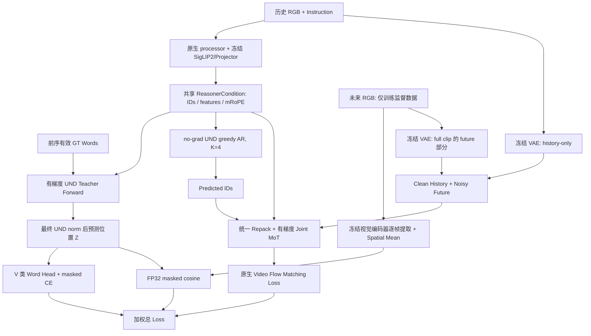

# PhysWord × Cosmos3-Edge：第二轮独立 Pre-M4 复审

审查日期：2026-11-01（Asia/Shanghai）。**当前结论：M4-A NO-GO；M4-B NO-GO。** 两者的阻塞原因不同：纯 Reasoner SFT 不依赖视频 RF 正确性，但仍缺真实预训练资源、语义初始化和可接入的任务标签协议；完整 Video SFT 还存在本轮实测失败的连续 RF 时间适配。

本轮没有修改模型代码、默认训练配置或数据，没有下载模型，没有启动正式训练。执行了允许范围内的轻量测试，包括 Tiny 的独立 backward、单次 optimizer update 和恢复验证。新增物仅为本文及 [本轮原始证据](physword_pre_m4_v2_results/summary.json)。这些单步测试不是模型学习效果或正式 SFT 成果。

## 1. 审查对象与证据边界

| 对象 | 本次确认的版本/位置 |
|---|---|
| 模型仓库 `M` | `/aifs/lijiawang/physword/cosmos-framework`，分支 `physword/m0-m1-visibility`，HEAD `ee6288f73f1ff3b4b6566bb6192360f029687c8c` |
| 数据仓库 `D` | `/aifs/lijiawang/physword/cosmos-framework-data`，分支 `physword/data-pipeline`，HEAD `e89480ad6ff920da5f2f2e0942d6435e61e42e05` |
| NVIDIA 原生代码参考 | 同一仓库基线 `55f0554d0bf167603432041c794a8babbac759b9`；本轮重新在 `/tmp/physword-m01-baseline` 执行 Tiny PW-off 对比 |
| 模型 snapshot `W` | `/aifs/lijiawang/physword/Cosmos3-Edge`，revision `344d602b128d1bbdacb43b08d0a3626f46343e29` |
| 真实数据 `P` | `/aifs/lijiawang/physword/data_pilot/badminton/scene_v2` |
| 设计与论文 | `/aifs/lijiawang/physword/docs/{physword_implementation_plan,physword_architecture_audit,pw_visibility_root_cause}.md`；本地 `physical word.pdf` §3.3–3.5、Appendix A.3；M0/M1、M2、M3 实现与报告 |

下文 `M/...:行号`、`D/...:行号` 均相对于上表目录，行号对应本次 HEAD。没有把另一 worktree 的模块当作当前模型实现。

本轮检查了 worktrees、分支、提交及工作区。模型实现仍为 M3 提交，没有后续修改；数据分支确有 scene vocabulary 与移除损坏 episode 的后续提交。关键源码 SHA256 与 `ee6288f` 一致，见 [source_snapshot.json](physword_pre_m4_v2_results/source_snapshot.json)。用户已确认“没有新分支”。因此不能将尚未落地的模型修复视作已实现。

| 验证层次 | 本轮能支持的结论 |
|---|---|
| 架构正确 | 受测单样本路径保留双 Transformer MoT，PW→GEN 可见性、因果 shift 和梯度通路成立；数据双臂协议尚未接入 |
| 训练代码可执行 | Tiny/Synthetic A+B+C 在现有离散表内 timestep 可 forward/backward/update；任意连续 timestep 测试失败 |
| 真实预训练权重已验证 | **否**：五个文件仍为 LFS 指针；真实 tokenizer/权重加载与训练都 BLOCKED |
| 具有实际学习效果 | **未验证**：没有真实数据拟合、生成质量或有效对照实验；非零 intervention 不能替代学习证据 |

## 2. 上轮五项阻塞的关闭状态

| 上轮事项 | 当前关闭状态 | 本轮直接证据 |
|---|---|---|
| 连续 RF 时间协议 | **未关闭** | `training.py:150` 仍 sample→离散查表→反查 sigma；三个非表内 timestep 均实际失败；同 seed 采样显著偏离原生 |
| 预训练语义初始化 | **未关闭，初始化代码也未实现** | `conditioning.py:88` 为 seeded Gaussian，head 复制随机 PW rows；没有 tokenizer subword pooling 或 base embedding 初始化 |
| 五个 LFS 文件 | **未关闭** | 本轮 preflight：五个独立文件均为 133–135 字节指针；对应本地 LFS object 不存在 |
| 评测、Baseline、Resume | **部分完成** | 本轮 Tiny optimizer/RNG/下一步恢复 PASS；真实实验配置、scheduler、数据进度恢复未闭环；现有真实窗口全 Train；Matched RGB-prefix 对照未接入 |
| 数据词表与模型不一致 | **数据侧部分完成，模型侧未关闭** | 数据有版本/顺序 fingerprint、25 类明确词义和拒绝误接保护；模型仍固定 16 类/17 rows，真实数据桥接实际报错 |

## 3. P0：连续 Rectified Flow 协议，数值复核

### 3.1 源码调用链与八项核查

原生链为 `OmniMoTModel.training_step()` → `_get_train_noise_level_vision()` → `RectifiedFlow.sample_train_time(..., shifts=...)` → `timesteps = sigmas * N` → pack/noising → `Cosmos3VFMNetwork` → `compute_flow_matching_loss()` → 一次 loss scale。

精确位置：`M/cosmos_framework/model/generator/omni_mot_model.py:1549,2403,2491,2496,2633,2663,2016`；`M/cosmos_framework/model/generator/diffusion/rectified_flow.py:134,160,167,176`。

**原生 Edge 视频训练默认分布是 `waver`，不是 `logitnormal`**：`M/cosmos_framework/configs/base/experiment/sft/models/edge_model_config.py:109,115`。分辨率 shift 为 256→3、480→5、720→10，weight=`uniform`，normalize-by-active=False，loss scale=10。图像/action 的 logitnormal 配置不能当作视频默认配置。M3 probe 的 `RectifiedFlow(None, shift=3)` 则默认 uniform（`M/cosmos_framework/scripts/physword_m3_probe.py:52`）。

| 核查项 | 当前实现判断 |
|---|---|
| 连续 sigma 采样与 shift | **FAIL**。M3 未调用原生 resolution-shift helper；无 shifts 地 sample 后把结果作为下降 scheduler 表的离散索引，不能等价于连续 warp |
| `t = sigma * N` | 原生直接成立；M3 对表内值也可数值成立，**这不足以证明采样分布一致**；非表内值反查失败 |
| Timestep Embedding | **PASS（组件/Tiny）**。仍为原生 `TimestepEmbedder`，没有新增离散 `nn.Embedding`。`cosmos3_vfm_network.py:399,946,1131` 接收 FP32 timestep，乘 0.001，再进入原生 embedder |
| 加噪 | **PASS（组件/Tiny）**：`(1-sigma)*x0 + sigma*epsilon`；M3 最后恢复历史 latent，与原生 history effective-sigma=0 等价 |
| velocity target | **PASS（组件/Tiny）**：`epsilon-x0`，符号一致 |
| History Condition Mask | **PASS（受测 5+16）**：latent mask `[1,1,0,0,0,0]`，前两帧不加噪、不计 loss 分子 |
| weighting / reduction / scale | **PASS（当前 uniform weighting 配置）**：原生 helper；默认分母包括全部 6 latent frames；scale=10 只乘一次。`training.py:170,180` 与 `algorithm/loss/flow_matching.py:126,143,154,158` |
| 连续训练与推理语义 | velocity 定义一致，但 **M3 时间适配未通过**。原生 UniPC 配置未改；PW 完整 sampler/CFG 未验收，不能把单步 velocity 当完整推理闭环 |

`get_discrete_timestamp()` 的“离散”发生在采样/查表阶段，而非网络 timestep embedding。最小修复必须改时间适配，不能更换原生 embedder。原生 RF 文件和 MoT attention 相对基线无改动；flow loss 只有 TYPE_CHECKING import 调整，loss 数学未重写。

### 3.2 本次运行与数值

使用 [rf_and_mask_review.py](physword_pre_m4_v2_results/rf_and_mask_review.py)，结果 [rf_and_mask.json](physword_pre_m4_v2_results/rf_and_mask.json)。固定 seed=20261101，FP32 sigma，N=1000。

采样对比调用从当前源码 AST 提取的**未改写** `_get_train_noise_level_vision()` 方法，用 fixture 提供 self/config；不是实例化整个 Omni trainer。每组 B=8，原生与 PW 序列前重设相同 RNG。覆盖真实 Edge 默认 `waver` 及额外 logitnormal 配置、三种 resolution shift。

| 分布 | resolution / shift | sigma max abs 差 | sigma RMS 差 | 判定 |
|---|---|---:|---:|---|
| waver（Edge video 默认） | 256 / 3 | 0.699844241 | 0.288823605 | FAIL |
| waver | 480 / 5 | 0.604793429 | 0.241626993 | FAIL |
| waver | 720 / 10 | 0.445881248 | 0.171895057 | FAIL |
| logitnormal（额外配置） | 256 / 3 | 0.595835686 | 0.311735660 | FAIL |
| logitnormal | 480 / 5 | 0.494655132 | 0.249665275 | FAIL |
| logitnormal | 720 / 10 | 0.342148721 | 0.165046126 | FAIL |

两条路径各自的 `t - sigma*N` max abs 均为 0；这再次说明该等式单独不能检测错误采样。

随后固定 Tiny 权重、历史、指令、预测词与 noise，对三个指定 sigma 调用**未修改的 `PhysWordTrainingStep`**：

| sigma | FP32 timestep | 完整 PW step | 反查返回 |
|---:|---:|---|---|
| 0.12345 | 123.45000458 | FAIL | shape `[0]` |
| 0.3746 | 374.60000610 | FAIL | shape `[0]` |
| 0.82731 | 827.30999756 | FAIL | shape `[0]` |

均报 `RuntimeError: shape '[1, 1, 1, 1, 1]' is invalid for input of size 0`，定位 `training.py:154–158` 的精确表项匹配/reshape。

为定位故障，另做**绕过失败适配器的组件测试**，直接给原生 noising/pack/网络传连续 sigma/t；没有将此标记为完整 step 通过。三个 sigma 下：原生 effective-mask noising 与 M3 恢复历史方式、显式加噪公式、velocity target、历史 latent、embedder 输入、packed/direct timestep embedding、原生 loss 与 masked MSE，max abs 差均为 **0**。raw loss 分别 **1.251621604、1.256380677、1.260273576**，scale 后分别 **12.516216278、12.563806534、12.602735519**。

覆盖边界：随机 Tiny Edge/SigLIP/Wan，B=1，5+16，FP32 master/BF16 AMP，single-device two-way，无正式训练；未覆盖真实权重、动态 token-count shift、diffusion forcing、分布式或完整采样器。原有 118 测试主要用表内 timestep，故其 PASS 与这里的 FAIL 并不矛盾。

## 4. 任务词表、Mask 与语义初始化

### 4.1 词表：数据有保护，模型未动态化

数据侧 `D/cosmos_framework/data/generator/physword/vocabulary.py:12,44` 验证唯一词/定义并保存 vocabulary ID + **有序词列表**的 hash；`dataset.py:35–43` 拒绝 fingerprint 不符或混合词表。Unknown/idle 被排除；`rest`、`hold` 是新版定义中的合法状态，不能视作 unknown。

模型侧仍将以下内容固定为原 16 类：

- `M/cosmos_framework/model/generator/physword/conditioning.py:18,36,84,85`：ATOMIC_ACTIONS、17 embeddings、16-way head、private token mapping。
- `M/cosmos_framework/model/generator/physword/multimodal.py:132`、`training.py:53`、`losses.py:29`：硬编码类别范围和 logits 末维。
- `M/cosmos_framework/model/generator/physword/checkpoint.py:17,56,88`：检查固定全局词表，未读取数据 vocabulary manifest。

真实样本读取成功，历史 `[5,3,480,640]`，未来 `[16,3,480,640]`；调用 `to_m3_batch()` **BLOCKED**，实际异常：`Scene vocabulary cannot feed the legacy 16-class M3 Word Head; explicitly adapt model vocabulary and per-arm targets first`。这是 `D/cosmos_framework/data/generator/physword/dataset.py:237` → `vocabulary.py:48` 的正确保护，不应移除或绕过。见 [real_data_bridge.json](physword_pre_m4_v2_results/real_data_bridge.json)。

不要求强制 16 类或 25 类。当前有效标签只出现 13 个词，可在明确任务/单轨协议后冻结适合该任务的有序子词表；模型应随 manifest 得到 head `[V,D]`、embedding `[V+1,D]`，并将 class→private token 映射、定义版本、hash 纳入 checkpoint。**仅把 16 改成 25 仍不能解决双臂 `[2,4]` 与模型单轨 `[1,4]` 的不一致。** 初版设计明确单语义轨迹（Implementation Plan:29），不能静默摊平或随便挑一臂标签冒充场景词。

### 4.2 当前真实 Mask 与 Teacher Feedback

对当前全部 433 windows 重新统计（[data_audit.json](physword_pre_m4_v2_results/data_audit.json)）：

- 双臂目标 3464 个，有效 3332 个，masked 132 个，**Mask=3.81062356%**，有效率 96.1894%。边界不确定仍保留 mask，没有强填类别。
- 13 个有效词为 approach、align、rest、grasp、lift、rotate、hold、move、insert、release、retract、adjust、lower。
- **旧单轨 `pw_valid_mask` 有效标签总数为 0**。当前两臂同时具有有效 stage，旧 `label_at(..., effector=None)` 对并行动作拒绝归并（`D/cosmos_framework/data/generator/physword/annotation.py:79`）。因此双臂高覆盖率不能当成旧单轨训练覆盖率。
- 433 windows 的 reviewed 均为 False；VLM 标签尚不等于人工确认正确。论文 A.3 的人工标注质量结果不能迁移成当前数据的准确率。

模型的单轨 mask 机制本身通过：CE 只索引 valid labels；latent 在 FP32 中先筛 valid/finite/nonzero targets，再算 cosine；invalid targets 无梯度。`M/cosmos_framework/model/generator/physword/losses.py:28,41`。桥接当前将同一单轨 mask 传给 CE 和 latent（`D/cosmos_framework/data/generator/physword/dataset.py:244–251`），保守地跳过歧义 block 的两种监督。

`forward_teacher_words()` 在前一 block 无效时使用 `<pw_start>` 作为明确的 neutral missing feedback，**不把 class 0 当作 GT**（`training.py:61–64`）。本轮补测 mask `[True,False,True,True]`，将无效 label 从 -100 改成 999：所有后续 logits max abs=0，CE 差=0，有效 count=3，feedback ID=1073741824，正是 start ID。该检查证明无效标签值不会泄漏；neutral placeholder 的语义效果仍需后续小样本验证。

以上是 Tiny 单轨 mask PASS；真实 25 类双臂数据进入模型仍 **BLOCKED**，不能声称“新版 3.81% mask 已端到端训练验证”。

### 4.3 预训练语义初始化：尚未实现

`M/cosmos_framework/model/generator/physword/conditioning.py:88–94` 以独立 seed 生成 N(0,0.02)，Word Head 复制这组随机 embedding 的词行；`<pw_start>` 也来自随机表。没有从真实 UND input embeddings 取值、没有多 subword pooling，也没有 start 来源记录。

PW 模块在 `Cosmos3VFMNetwork.__init__:460–469` 注册，早于 optimizer；此点正确。`load_base_state():30` 只允许缺两个 PW keys 并严格检查其他 key/shape，但没有“加载 base 后初始化 PW”的流程。因此当前必须分别记为：**初始化代码未实现；真实预训练初始化验证 BLOCKED**。Tiny roundtrip 保存随机初始化后的参数不构成语义初始化成功。

最小修复：冻结 task manifest，实际 base 加载成功后，用匹配 tokenizer 对普通词分词、记录 subword IDs、按明确 mean pooling 从 UND input embedding 初始化；明确 head 来源（设计允许对应 base LM-head rows 均值）与 start 的 base token/向量来源。warm-start 仅初始化新 PW；resume 必须加载已有 PW，不再次随机或语义重置。保存初始化 provenance，并验证加载顺序与 optimizer 覆盖。

## 5. A+B+C 计算图、Attention 与梯度

### 5.1 实际模块调用链



当前 V=16；Tiny D=128/2 层，真实设计 D=2048（尚未用真实权重运行）。调用位置：

| 分支 | 实现与 shape/边界 |
|---|---|
| 共享 prefix | `M/cosmos_framework/model/generator/physword/multimodal.py:174` → 原生 chat template、`prepare_multimodal_reasoner_inputs()`、SigLIP2+Projector；恰好 5 个历史帧，保存冻结视觉特征及 mRoPE；禁止未来容器进入 |
| A | `training.py:57,128`；若 context 长度 C，输入 `context,start,GTw1,GTw2,GTw3`；prediction positions `[C,C+1,C+2,C+3]`，GT token positions 比预测位置后移 1；第 4 个 GT 不输入 |
| Z/损失 | `unified_mot.py:1978–1985` 返回最终 UND norm 后状态；Z `[1,4,D]`，logits `[1,4,16]`，不使用完整 LM vocabulary；`losses.py:11` 分别编码未来 container offsets `[3,7,11,15]`，mean 后 target `[1,4,D]` |
| B | `M/cosmos_framework/inference/physword.py:34–73`；fresh prefix，无 future/GT 参数，4 步 greedy；第四个 sampled token 显式再 forward 一次填满 cache，不预测第五词 |
| C | `inference/physword.py:77`，`training.py:163–169`；仅使用 B 的 `prediction.condition`，加入 start+4 words+EOS+BOV，共 7 个 suffix tokens；重新 embedding，重新计算逐层 K/V，不传 detached final-z 或 AR cache 给 GEN |
| GEN 输入 | history-only VAE latent `[1,48,2,h,w]`；full clip `[1,48,6,h,w]` 取未来 4 latent；pack `[1,48,6,h,w]`，history mask 前 2；Tiny h=w=4 |

只保留原生 UND/GEN 两套 QKV、FFN。`M/cosmos_framework/model/generator/mot/unified_mot.py:833–838` 从 pre-RoPE UND K 做 `k_norm_und_for_gen` 后再 RoPE；`attention.py:202` 的 two-way 为 UND causal→UND、GEN full→同样本 UND+GEN。因此 GEN 每层可读 PW K/V，UND/PW 不可读 GEN。M1 不等长样本 offsets 隔离通过。

当前每个 block 只有单轨、单 visual word，所以 blockwise causal 退化为普通逐词 causal；这不是论文双臂/多模态 block mask 的完整实现。数据要切换为双臂不能直接沿用当前单轨排列。

没有新增 Transformer、原 PhysWord Backbone、Final-z Injection、Direct KV Handoff、Action/Tactile condition。原生仓库存在 action 模块/配置不代表本 PW 路径启用 action；`inference/physword.py:94` 明确拒绝非 RGB 模态输入。

### 5.2 detach/no-grad、训练推理一致性

prefix 视觉特征 detach、未来视觉 teacher no-grad、VAE no-grad 是冻结设计；C 对 private IDs 重新 lookup，PW table 和 UND 参数仍有梯度。B 为 no-grad/临时 eval，结果为离散 IDs；**不通过 argmax 反传**。A 和 C 的 UND 计算保持梯度。没有发现已测试路径中意外的 C→PW/UND detach。

Video loss 经 GEN attention 的 UND K/V 回传：倒数前各层可影响后续 K/V；最后 UND 层的 input norm、K/V projection 有梯度，最后层 Q/O、MLP、post-attention norm、UND final norm 和 Word Head 没有直接 video 梯度，符合该图，不能误报为断裂。

T03 对当前 GT 替换、future target 修改分别验证；**未发现受测路径 future condition leakage**。C 的 noisy future 本来就由训练 target x0 加噪得到，不能把正常 flow training input 误判为把 future 塞入 Reasoner。

T06 对每层 input/output hidden、raw K/V、GEN-normalized K 与 prediction states，BF16 与 FP32-master/BF16 AMP 两种受测路径 max abs 全为 0；T11 grad/no-grad packed/velocity 差=0。EOS/BOV 在 4 个预测词后，因果性不影响前面的 PW parity。此结论不覆盖非零 dropout、真实 28 层运行、CFG 或 Joint KV cache。

FSDP/AC：`training.py:107`、`optimization.py:41`、`inference/physword.py:40` 拒绝非空 parallel_dims；本版只支持 unsharded B=1。原生 `reasoner_forward` 直接遍历 layer，当前 M3 没有接入训练 activation-checkpoint wrapper；没有证据证明已支持 FSDP hooks/AC。保持本轮单设备范围可用，不能为真实显存问题擅自启用多卡。

### 5.3 本轮三项 Loss 与独立 backward

本轮重新执行 T09，非历史引用。fixture：Synthetic uint8，随机 Tiny 权重、原生小尺寸 SigLIP/Wan、固定 noise 和 **表内** timestep（不是连续 RF 修复验证）。λ_word=λ_latent=1。

| 项目 | 数值 |
|---|---:|
| raw video | 1.2602672577 |
| scaled video | 12.6026725769 |
| word CE | 2.6092789173 |
| latent cosine | 1.0144643784 |
| Phase B total | 16.2264156342 |
| Phase A total | 3.6237432957 |
| 有效数量 | word=4、latent=4，各 1 sample；video=3072 noisy elements、1 sample |

各 Loss 单独 backward 的参数组 L2 Grad Norm：

| Loss | PW embedding | Word head | UND | GEN | UND-for-GEN K norm |
|---|---:|---:|---:|---:|---:|
| Video | 0.12960735 | 0 | 1.87047524 | 8.27421873 | 0.00893324 |
| CE | 2.18998981 | 5.83854723 | 9.34323109 | 0 | 0 |
| Latent | 1.10371351 | 0 | 6.97057306 | 0 | 0 |

逐完整参数名记录见 [gradients.json](physword_pre_m4_v2_results/gradients.json)。这证明视频确实使用可训练 PW/UND 路径，并不证明这些随机词已学会物理语义。

### 5.4 Optimizer 收集与实际更新

`optimization.py:47–58,115–124` 使用完整 module path 构造完整参数名，拒绝缺失/重复/重叠，先完成 allowlist 再修改 requires_grad。要求 FP32 master；SigLIP2+Projector、base token embedding 和 VAE 冻结。PW 已在 optimizer 构建前注册。

本次 Phase B 单次 step：

| Group | 参数量（Tiny） | LR | total Grad Norm | 实际 update L2 |
|---|---:|---:|---:|---:|
| pw_embedding | 2176 | 1e-4 | 2.34845257 | 0.0022626910 |
| word_head | 2048 | 1e-4 | 5.83854723 | 0.0045254845 |
| und（选中两层+final norm） | 230016 | 1e-6 | 10.79916950 | 0.0004524483 |
| gen | 329024 | 1e-5 | 8.27421873 | 0.0057264615 |
| gen_und_k_norm | 64 | 1e-5 | 0.00893324 | 0.0000800249 |

所有被选参数 tensor 均实际改变，所有冻结参数与 VAE 均不变。Phase A 的前三组 update L2 为 0.0019595386、0.0045254845、0.0004524811，GEN 冻结。完整名称/每个 tensor 差异见 [step-A.json](physword_pre_m4_v2_results/step-A.json)、[step-B.json](physword_pre_m4_v2_results/step-B.json)。当前 AdamW 使用 PyTorch 默认 betas/eps 及配置 weight_decay=0.01，不应宣称与论文/原生 SFT 的 optimizer recipe 完全一致；后续实验需明确记录。

## 6. 本轮 T01–T14 测试矩阵

PASS=本次当前代码实际执行通过；FAIL=本次反例失败；NOT RUN=本轮未运行/尚未实现；BLOCKED=依赖不具备。表中 Tiny 是原生网络的小尺寸随机权重与 fixture tokenizer/Synthetic RGB，不是真实预训练 Edge。真实标注数据只执行 CPU 检查/读取/桥接，没有端到端模型 forward。

| 测试 | 本轮 Tiny/Synthetic 状态与范围 | 真实 Edge 权重 | 真实标注 Dataset | 限制/证据位置 |
|---|---|---|---|---|
| T01 PW-off | **PASS**，原 commit 与当前重跑 max abs=RMS=0，另有 off 回归 | BLOCKED | NOT RUN | `visibility_test.py:143`；baseline_comparison.json |
| T02 presence/packing | **PASS**，IDs、prediction/token positions、offsets、不等长样本 | BLOCKED | BLOCKED：词表桥接 | `visibility_test.py:55`、`multimodal_test.py:50` |
| T03 shift/future leakage | **PASS**，各 GT 改动、future-only 变化、B/C 不用 GT | BLOCKED | BLOCKED：模型验证；CPU 时序检查 PASS | `multimodal_test.py:77,118`、`training_test.py:279` |
| T04 attention reference | **PASS：forward**；**NOT RUN：reference 梯度对齐** | BLOCKED | NOT RUN | `visibility_test.py:219` 为 no-grad；T09 不能替代此梯度参考 |
| T05 sample isolation | **PASS：M1 varlen**；**NOT RUN：M2 多样本 RGB** | BLOCKED | NOT RUN | `visibility_test.py:201`；M2 明确 B=1 |
| T06 AR/repack | **PASS**，逐层 raw/norm K/V、hidden、positions、最后词 flush；AMP 亦 PASS | BLOCKED | BLOCKED | `multimodal_test.py:50`、`training_test.py:398` |
| T07 intervention | **PASS**，手工 pick/push 与预测轨迹替词 | BLOCKED | BLOCKED | `visibility_test.py:158`、`multimodal_test.py:195`；不代表词义有效 |
| T08 suffix mask-out | **PASS**，全部 7 suffix 位置、每层、换词不变 | BLOCKED | BLOCKED | `training_test.py:46`；诊断 forward，不是辅助-only 训练对照 |
| T09 independent gradients | **PASS，本次重新 backward**，video/CE/latent 分开 | BLOCKED | BLOCKED | `training_test.py:87`，gradients.json |
| T10 optimizer step | **PASS，本次 A/B 各一步与冻结检查** | BLOCKED | BLOCKED | `training_test.py:131`，step-A/B.json |
| T11 train/infer condition | **PASS**，相同条件、grad/no-grad velocity max abs=0 | BLOCKED | BLOCKED | `multimodal_test.py:93`；不含完整 sampler/CFG |
| T12 CFG/cache | **NOT RUN**，M5 范围，未实现完整 PW Joint cache/CFG | NOT RUN | NOT RUN | AR 内部 cache flush 不等于本项通过 |
| T13 visual/VAE leakage | **PASS**，原生 Tiny VAE 两种 temporal window、未来 target 独立、history-only | BLOCKED | BLOCKED：真实 VAE 编码；CPU 帧映射 PASS | `multimodal_test.py:118,148,173`、`training_test.py:319` |
| T14 checkpoint/tokenizer | **PASS：同 factory Tiny roundtrip**；**NOT RUN：完整实验 resume** | BLOCKED | BLOCKED | `training_test.py:164,220,238`；动态 task vocab 尚不支持 |

现有测试总计 **118 PASS / 0 FAIL / 0 SKIP**，数据测试 **55 PASS / 0 FAIL / 0 SKIP**，JUnit 时间分别 17.236s、2.962s。**补充 RF 审计中的 FAIL 独立于这两个 pytest suites，不能用“173 项通过”概括为整体通过。**

T08 本轮数值：visible velocity RMS=**0.9756876230**；换词 RMS difference=**0.003584317630**；相对差=**0.003673632365（0.367363%）**；重复同输入 numerical floor=**0**；masked 换词差=**0**；masked repeat floor=**0**；visible/masked 差=**0.005515067838**。完整 mask 是 UND indexes 81–87（start、四词、EOS、BOV）。

`inference/physword_diagnostics.py:109–161` 在每层保持 UND 原生结果，GEN 用 SDPA 排除整个 suffix，禁止 cached memory；这是局部诊断，不是修改生产 MoT。由于 masked 与 visible 使用的 kernel 可以不同，visible/masked 差不能全归因于 PW 语义；masked 条件下替词严格不变才是此处的核心可见性证据。

历史 `docs/physword_m01_results`、`physword_m2_results`、`physword_m3_results` 仅作对照，不作为本表 PASS 的替代。第一轮未重新执行 backward/step 的限制，本轮已由实际 T09/T10/T14 重跑补齐；真实权重层面的空白仍在。

## 7. 真实资源、时序与评测协议

### 7.1 权重和 tokenizer

本轮 [preflight.json](physword_pre_m4_v2_results/preflight.json) 和 [cache_scan.json](physword_pre_m4_v2_results/cache_scan.json) 显示：

| `W` 下文件 | 当前 bytes | LFS 声明真实 bytes | 阻塞模块 |
|---|---:|---:|---|
| `transformer/diffusion_pytorch_model-00001-of-00002.safetensors` | 135 | 5,000,040,072 | UND / GEN shared checkpoint shards |
| `transformer/diffusion_pytorch_model-00002-of-00002.safetensors` | 135 | 1,739,335,512 | UND / GEN shared checkpoint shards |
| `vision_encoder/model.safetensors` | 134 | 978,739,880 | SigLIP2 + Projector bundle |
| `vae/diffusion_pytorch_model.safetensors` | 135 | 1,409,400,600 | Wan VAE |
| `tokenizer.json` | 133 | 17,077,500 | 真实 tokenizer |

合计需约 9.145 GB 的真实文件；preflight 的 8 个 component references 去重后是这 5 个文件，不是 8 个缺失模型。索引/config 存在，reasoner/GEN dimensions、VAE channels/time compression、patch width、GEN UND K norm 的**元数据**检查通过；tensor shapes 与 tokenizer IDs 尚无法验证。真实 Missing/Unexpected Keys/Shape Mismatch 状态应写 **BLOCKED/未执行加载**，不能写“无 missing keys”。

对应五个本地 `.git/lfs/objects` 对象不存在；在记录的 8 个常用 cache/model 根目录范围内没有找到 Cosmos 替代副本。这不是对全部 AIFS 的穷尽扫描。预期来源为同一固定 `nvidia/Cosmos3-Edge@344d602b...` snapshot 的上述对象；本轮未下载。

最小补齐方案：优先定位已有完整同 revision 共享缓存并核验 OID；没有则在单独获准资源准备任务中只补这五个文件及匹配现有 config/index。完成后执行实际 safetensors key/shape 检查、tokenizer special/max ID 与 embedding rows 检查、原生→PW 只缺新 PW keys 的 warm-start 验证。不能拿别版本 tokenizer 临时绕过。

原生 SFT recipe tokenizer pin 为 `2a00e87e...`（`M/cosmos_framework/configs/base/experiment/sft/models/edge_model_config.py:170–175`），与当前本地 `344d602b...` 不同；这不是已证实 shape 不兼容，但必须选择整套匹配 snapshot 并实际核验，不能混用而称版本通过。VAE 正式 encode adapter 也必须使用该 checkpoint 的 normalization；当前 Tiny 使用 identity normalization。

### 7.2 当前真实时间范围

对全部 433 windows 重新核对，**当前确实仍是 5+16、K=4、stride=4、10Hz**，不是沿用旧报告假设。PW horizon=4×4/10=**1.6s**，视频未来 horizon=16/10=**1.6s**；零 horizon mismatch，零 target-frame/causal-history mapping 错误。

以首窗口为例，历史模型帧 `[0..4]`，未来 `[5..20]`：

| block | PW target / full RGB frame | 模型相对时间 | 实际 RGB capture 相对时间 | full-clip VAE latent 右边界位置 |
|---|---:|---:|---:|---:|
| 1 | 8 | 0.8s | 0.782800s | 2 |
| 2 | 12 | 1.2s | 1.181307s | 3 |
| 3 | 16 | 1.6s | 1.581843s | 4 |
| 4 | 20 | 2.0s | 1.984552s | 5 |

当前历史末帧模型时间 t=0.4s，因此最后 target 是 t+1.6s，而不是未来 2.0s。causal 抽帧选择不晚于模型采样点的实际观测，标签使用选中帧的真实 source timestamp；不应把二者存在几毫秒偏差误报为错位。Wan temporal compression=4，21 帧→6 latent，右边界 `[0,4,8,12,16,20]`；历史 5 帧→2 latent，未来 4 latent；这是时间对应，不代表每个 latent 只包含一张 RGB。

源码：`D/cosmos_framework/data/generator/physword/windows.py:12,77`，`M/cosmos_framework/model/generator/physword/multimodal.py:24–43`、`losses.py:17`、`training.py:142–149`。模型目前直接限制 5+16；这些数字是当前实现限制，不是论文不允许其他 horizon。

本地官方模型卡 `W/README.md:102` 写常规视频范围 12–30fps、50–150 frames，性能评测 `:253,272` 又使用 24fps、189 frames。当前 10Hz/21-frame 不在这些已说明的常规设置内。应区分：**架构 1+4m 时间长度支持；Tiny 代码已跑；真实预训练生成质量未验证**。不能据此宣称架构不支持 21 帧，也不能据 Tiny 能跑宣称预训练质量有保障。

发现配置防线仍不完整：`D/cosmos_framework/data/generator/physword/common.py:98` 仅禁止 PW horizon 大于 video future，没有要求相等。本轮 `PipelineConfig(future_frames=20)` 实际接受 PW=16/video=20（[data_contract_negatives.json](physword_pre_m4_v2_results/data_contract_negatives.json)）。当前433窗口未触发，但未来调参前必须把 mentor 的等式变成校验条件。

### 7.3 Split、标注与公平对照

当前全局 split manifest 为 206 episodes：186 Train、20 Test，先按 episode/source-content 分组再切窗；移除损坏 `episode_0038` 后继承其余 episode membership（`D/cosmos_framework/data/generator/physword/split.py:46,110,121`）。这项数据修复有效，不应恢复损坏视频来补 test 数量。

但已处理/标注窗口仅来自 episode_0001、episode_0017，共 433 windows，**全部 Train、Test windows=0**；validation_ratio 默认 0，当前没有独立 Val。早期报告里的 test窗口/旧三 episode 数字不适用于本轮 scene_v2。Episode split 逻辑通过测试并不等于真实评测数据已准备好。大量重叠窗口也不能当成433独立episodes。

最小对照要求：

| 条件 | 当前状态 | 后续必须固定 |
|---|---|---|
| Native Edge PW-off | Tiny baseline 本次 exact PASS；真实 BLOCKED | 同 snapshot、GEN clean history、未来帧数/FPS、噪声/连续 sigma、分辨率、评测 seeds |
| Matched RGB-prefix，无 PW | 未提供正式独立路径；`build_reasoner_prefix` 要求 PW enabled，`repack` 要求完整四词 | 保留相同 RGB/Instruction prefix，明确 suffix/position 协议；不能直接用 text-only off 代替 |
| Full Predicted PW | Tiny A+B+C 可运行，RF/真实资源/数据接口仍阻塞 | C 仅预测词；相同训练预算与参数策略；记录有效 label/latent counts |
| 整个 suffix masked 辅助对照 | 仅 T08 eval 诊断 | 若要因果归因，应另验证 video→PW 梯度被屏蔽、无 EOS/BOV 旁路，并统一训练/评测预算 |

Native 对照与 Full 之间存在 UND RGB prefix、token长度/位置等差异，必须有 matched prefix 对照才能把提升归因于 PW。诊断 overfit 可先于完整 test集，但不得因此声称泛化提升。

## 8. Checkpoint 与恢复

本轮 T14 重新执行，通过：17 private ID 映射；word logits max abs=0；predicted IDs 相同；one-step velocity max abs=0；Adam moments 相同；torch CPU/CUDA RNG 相同；下一次更新相同。损坏 manifest/processor/hash、错误非 PW keys/shape 的拒绝测试也通过。见 [roundtrip.json](physword_pre_m4_v2_results/roundtrip.json)。这是独立小表映射恢复，不是向原 HF tokenizer 新增了17个普通词。

当前 `M/cosmos_framework/model/generator/physword/checkpoint.py:41–112` 保存 network/optimizer、单设备 torch RNG、processor/tokenizer、phase/losses/revisions/固定 mapping；这是有效的 **同 factory Tiny bundle**。

尚未保存或严格核验：完整 network 行为配置（如位置编码参数）、RF distribution/shift/N/推理 scheduler、LR scheduler 状态、外部 VAE 参数/normalization provenance、数据 manifest/split/vocab 定义 hash、sampler/iterator 进度、Python/NumPy/worker RNG。`revisions` 是调用者给出的字符串字典，不能自动保证这些配置一致。

T14 重新使用同一个 `synthetic_training()` factory 和固定 noise/timestep，所以未证明跨运行重建真实实验的连续性。新 task vocabulary 目前也不在恢复接口中。对固定 LR 的单步 probe 不保存 LR scheduler 没有即时影响；一旦 M4 用 warmup/decay，必须保存/恢复或通过已保存 step+冻结配置确定性重建并检验下一次更新。FSDP/DCP resume 不在本轮宣称范围。

## 9. 按严重程度排序的问题与最小修复

这里 P0 表示启动相应 M4 阶段前不能跳过的阻塞；P1 是协议/实验可靠性问题；P2 是范围内可记录、扩大前应补的验证。

| 级别 / 问题 | 文件、函数、证据 | 最小修复与关闭标准 |
|---|---|---|
| **P0-1：RF 连续时间适配错误（M4-B）** | `M/cosmos_framework/model/generator/physword/training.py:150–158`；本轮六组采样差、三个非整数 timestep FAIL | 复用原生分布/shift resolution，直接 sigma→t=Nσ，取消训练反查离散表；用相同 noise、weights、mask 比 noising/embedding/loss/梯度，真实单步再验 |
| **P0-2：任务词表/单轨-双臂接口未接通（A/B）** | `conditioning.py:18,84`、`losses.py:29`、`D/cosmos_framework/data/generator/physword/dataset.py:237`；真实桥接 BLOCKED，旧单轨0有效 | 明确单任务单语义轨迹或明确 effector 选择；冻结实际必要词 manifest，动态 V/V+1，贯穿 label/token/CE/TF/checkpoint；保留 mask，禁止伪填 GT |
| **P0-3：五个真实资源仍缺失（A/B）** | `W` 五文件；本轮 preflight/LFS OID | 同 revision 补齐、实际 key/shape/tokenizer 验证；真实 A 一步与 B 一步分别验收，不能用 metadata PASS 替代 |
| **P1-1：预训练语义初始化不存在** | `PhysicalWordEmbedding.reset_parameters():88`，随机表/head | base load 后按明确 subword pooling/start/head 来源初始化；持久化来源；测试 warm-start/resume 顺序及真实 rows 数值 |
| **P1-2：完整实验恢复未闭环** | `checkpoint.py:52–71,85–111`；Tiny同factory T14 PASS但缺配置/数据进度 | 保存并严格校验完整实验 manifest/RF/VAE/vocab/data/scheduler/RNG；fresh process恢复后相同下一 batch、sigma、loss和更新 |
| **P1-3：当前真实 Test/Val 为空，matched baseline 未实现** | `P/windows.jsonl` 本轮433全Train；`multimodal.py:182`、`inference/physword.py:86` | 从既定 split 中补有效评测 episodes，固定 train 内 Val；实现同 RGB-prefix 对照；不重新按窗口随机 split |
| **P1-4：有效双臂标签不等于单轨训练数据** | `D/cosmos_framework/data/generator/physword/annotation.py:79`、`windows.py:70,74`；96.19%双臂有效但单轨0 | 与P0-2一起闭环；人工抽查拟 overfit 的片段/边界，保留不确定 mask；不能丢弃 metadata 假装旧数据可训练 |
| **P2-1：horizon 等式未在通用数据配置强制** | `D/cosmos_framework/data/generator/physword/common.py:98`；16 PW /20 future 实际被接受 | 改为当前协议严格相等，测试不相等拒绝；当前5+16本身通过 |
| **P2-2：vocab hash 不含 definitions** | `D/cosmos_framework/data/generator/physword/vocabulary.py:44`；相同ID/words但更改定义 hash仍相同 | 将定义/协议版本纳入独立语义 fingerprint；label顺序保护已有，不应误说完全无版本保护 |
| **P2-3：T04 梯度参考、T05 多样本 RGB 缺口** | `visibility_test.py:219` no-grad；M2 B=1 guards | 补 attention reference backward；多样本留后续范围，当前明确B=1 |
| **P2-4：真实显存、10Hz短视频质量未证实** | `training.py:127` 同时保留A/C图；官方卡常规范围 | 资源准备后先真实单步预算/生成基准；不由Tiny推断H100容量或生成质量，不提前上FSDP/CFG |

## 10. M4-A / M4-B 的分别启动结论

### M4-A：真实数据 PW Reasoner 小规模 SFT — **NO-GO（当前）**

纯 CE+latent 不使用 video RF，因此 **P0-1 不是 Phase A 的数学前置条件**，也无需完整视频评测体系才做诊断 overfit。但当前真实 UND/tokenizer/视觉 teacher 不完整、语义初始化未实现、25类双臂数据被模型接口拒绝，不能现在启动。

最小转为可启动的条件：真实 UND/SigLIP2/Projector/tokenizer 加载和初始化验证；确定任务单轨及词表；从 1–2 个 Train episodes 人工核对少量片段和 masks；用真实数据执行 A 的 forward/backward/冻结参数/保存恢复。VAE 数学上不参与 A 的 loss，但当前构造函数 `training.py:113` 仍要求 VAE 对象，应明确 Phase A 资源装配，不能宣称现有完整 factory 已无需 VAE。

上述条件关闭后，**可以先做少量 episodes 的有界 overfit，不必等 M4-B RF 修复**。建议起点：B=1，固定10Hz/5+16，冻结GEN/视觉teacher/VAE，PW/head LR=1e-4、少数指定 UND 层 LR=1e-6，λ_word=λ_latent=1；先真实一步验收，再经下一轮授权设定有限步数。记录 masked count、分词初始化、逐类CE/准确率、latent误差，保持诊断结论，不宣称泛化。

### M4-B：完整 PW-conditioned Video SFT — **NO-GO（当前）**

除 A 的资源/词表/初始化条件外，必须关闭连续 RF 反例；验证真实 Joint MoT 一步 video/CE/latent 独立梯度、exact optimizer groups 与 frozen checks、checkpoint fresh-process 下一步恢复、原生匹配 baseline。B rollout/C re-embedding 在 Tiny 中已成立，**不需要为修复 RF 重构已验证的 repacking 或 MoT Attention**。

当前不建议启动 H100 真实数据小样本 SFT。建议的下一项 GPU 工作是：在依赖补齐和相应修复后，分别执行 A 与 B 的 **真实单 batch 验收**；验证成功后才决定有界 overfit。当前测试使用 H100 跑 Tiny 不构成真实 H100 SFT 已就绪。M5 的 CFG、Joint cache、FSDP 不应成为本次未实现功能的掩饰，也不要求为最小单设备 M4 强行提前实现。

## 11. 本轮实际测试命令与证据

模型回归（工作目录 `M`）：

```bash
CUDA_VISIBLE_DEVICES=7 I4_ATTN_BACKENDS=flash3 COSMOS_TRAINING=0 \
HF_HUB_OFFLINE=1 TRANSFORMERS_OFFLINE=1 OMP_NUM_THREADS=1 \
PYTEST_DISABLE_PLUGIN_AUTOLOAD=1 \
/tmp/physword-m01-venv/bin/python -m pytest -c tools/physword_m01_pytest.ini \
  cosmos_framework/model/generator/physword/training_test.py \
  cosmos_framework/model/generator/physword/multimodal_test.py \
  cosmos_framework/model/generator/physword/visibility_test.py \
  cosmos_framework/scripts/physword_preflight_test.py \
  cosmos_framework/data/generator/sequence_packing/sequence_test.py \
  cosmos_framework/data/generator/sequence_packing/packers_test.py \
  cosmos_framework/model/generator/mot/include_gen_pathway_test.py \
  cosmos_framework/model/generator/algorithm/loss/flow_matching_test.py \
  -q --junitxml=/tmp/physword-pre-m4-v2/model_tests.xml
```

数据回归（工作目录 `D`）：

```bash
PYTHONPATH=. PYTEST_DISABLE_PLUGIN_AUTOLOAD=1 \
/tmp/physword-data-venv/bin/python -m pytest \
  -c tools/physword_data/pytest.ini --confcutdir=tests/physword_data \
  tests/physword_data -q --junitxml=/tmp/physword-pre-m4-v2/data_tests.xml
```

RF/部分 invalid feedback 补测（工作目录 `M`，实际执行时脚本在 `/tmp/physword-pre-m4-v2/`，同一内容已存入结果目录）：

```bash
CUDA_VISIBLE_DEVICES=7 I4_ATTN_BACKENDS=flash3 COSMOS_TRAINING=0 \
HF_HUB_OFFLINE=1 TRANSFORMERS_OFFLINE=1 OMP_NUM_THREADS=1 PYTHONPATH=. \
/tmp/physword-m01-venv/bin/python /tmp/physword-pre-m4-v2/rf_and_mask_review.py
```

原基线与当前基线均重新执行 seed=20261101：原基线工作目录及 PYTHONPATH 为 `/tmp/physword-m01-baseline`，用 `runpy.run_path(M/cosmos_framework/scripts/physword_probe.py)['run_probe'](output, baseline_only=True)` 调用，打印的 `Cosmos3VFMNetwork` 源路径确认来自基线 worktree。当前版本运行：

```bash
CUDA_VISIBLE_DEVICES=6 I4_ATTN_BACKENDS=flash3 COSMOS_TRAINING=0 \
HF_HUB_OFFLINE=1 TRANSFORMERS_OFFLINE=1 OMP_NUM_THREADS=1 PYTHONPATH=. \
/tmp/physword-m01-venv/bin/python -m cosmos_framework.scripts.physword_probe \
  --baseline-only --output /tmp/physword-pre-m4-v2/current_baseline
```

直接加载两次 `baseline_velocity.pt` 比较：exact equal=True，max abs=RMS=0，tensor SHA256 同为 `c114f25d5ec0d6257547b25c001aba1c113f895cd2ad78d6199a68ddb0381b02`。不是比两个历史 JSON hash。

最终资源检查亦通过以下命令重新执行，结果与前述 preflight 相同（files_complete=False、metadata_compatible=True、real_edge_forward_status=blocked）：

```bash
HF_HUB_OFFLINE=1 TRANSFORMERS_OFFLINE=1 \
/tmp/physword-m01-venv/bin/python -m cosmos_framework.scripts.physword_preflight \
  --checkpoint /aifs/lijiawang/physword/Cosmos3-Edge \
  --output /tmp/physword-pre-m4-v2/preflight_final.json
```

真实数据桥接使用 `D` 环境读取 `TrainingWindowDataset(P/windows.jsonl)[0]` 后调用 `to_m3_batch(sample)`，结果为上文 guard 异常；全433窗口的统计/时间映射另见 data_audit.json。模型文件检查只读取 metadata、pointer、缓存目录，没有触发 LFS 下载。

环境：Torch 2.10.0+cu128，Transformers 4.57.1，CUDA H100，Flash3，单设备；测试无 skip。requests dependency/deprecation 警告未导致失败。`COSMOS_TRAINING=0` 是环境设置，T09/T10 中仍显式开启 autograd/train 并执行实际更新，不能据该变量误读为只跑 inference。

原始 JUnit：[model_tests.xml](physword_pre_m4_v2_results/model_tests.xml)、[data_tests.xml](physword_pre_m4_v2_results/data_tests.xml)。其他小型 JSON 与审计脚本集中于 `docs/physword_pre_m4_v2_results/`，全部为本轮产物；未覆盖旧报告或旧测试证据。

**复审到此停止。没有启动 M4，也没有实施本报告建议的模型修复。**
